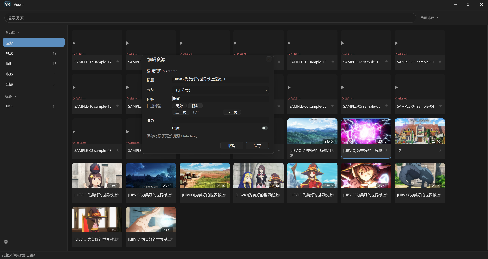
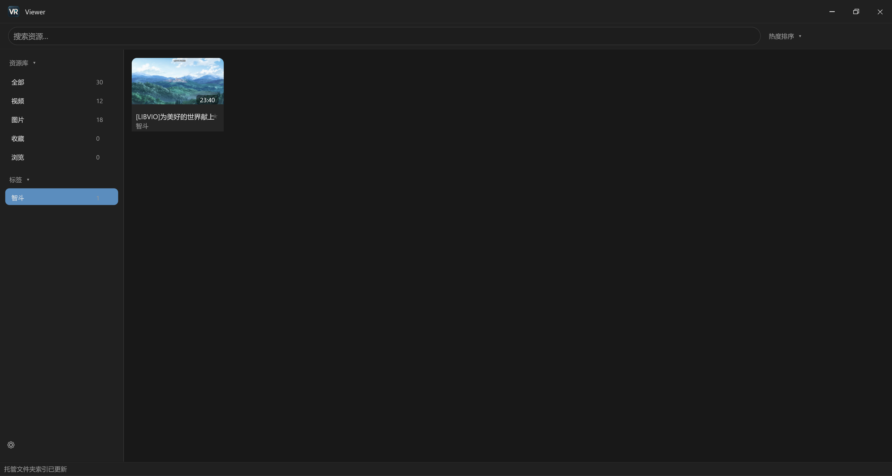
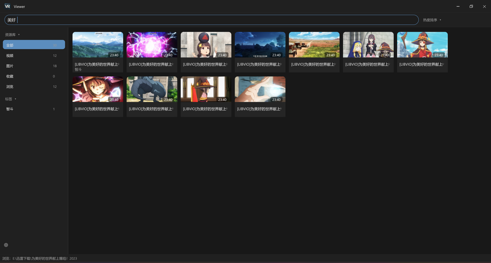
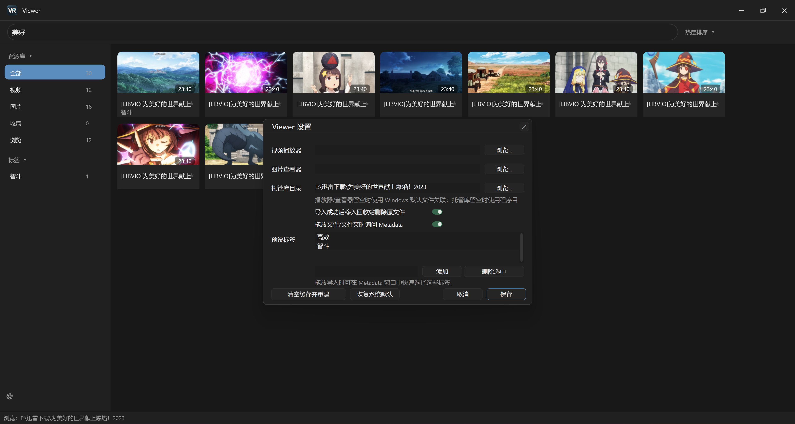

# Viewer

A native Windows video and image library manager.

**Viewer（VR）** 是面向 Windows 的原生本地视频与图片资源管理器，支持拖放导入、
自动归档、标签分类、元数据编辑、全文搜索和缩略图浏览。程序将媒体文件归档到
托管库，并使用 SQLite 保存资源信息，便于集中整理和检索本地媒体。

## 主要功能

- **快速冷启动**：冷启动速度快，主窗口优先显示，媒体扫描与缩略图加载在后台进行。
- **媒体导入与归档**：支持拖入多个文件或文件夹，递归识别媒体文件并归档到托管库，
  通过内容哈希检测重复资源。
- **标签与元数据管理**：可编辑标题、分类、标签、演员和收藏状态；支持自定义快捷标签，
  默认预设为“高效”和“智斗”。
- **搜索与筛选**：支持关键词、标签、分类、资源类型、收藏状态、最近打开时间和视频时长等条件。
- **缩略图浏览**：以网格展示视频和图片，支持视频时长显示、键盘选择、Ctrl/Shift 多选及右键操作。
- **排序与访问**：支持按最近打开、热度、最近添加、创建时间和文件大小排序；双击资源即可打开。
- **资源库维护**：提供数据库备份、元数据 CSV 导出、托管库扫描和缺失文件状态检测。

## 软件截图

### 1. 设置资源标签

在元数据编辑窗口中填写标签，或通过快捷标签按钮添加“高效”“智斗”等标签，
同时编辑标题、分类、演员和收藏状态。



### 2. 按标签查找资源

选择左侧标签栏中的“智斗”，即可查看具有该标签的资源。



### 3. 关键词搜索

在顶部搜索框输入关键词，快速检索匹配的资源。图中展示了“美好”的搜索结果。



### 4. 设置页面

通过左侧栏底部的设置入口，配置外部播放器、图片查看器、托管库目录、导入行为和预设标签。



## 使用指南

### 运行 Release 版本

下载 Windows x64 Release 压缩包，完整解压到可写目录后运行 `vr.exe`。
压缩包包含程序及所需运行库，首次启动会创建配置、数据库和缓存目录。

### 导入与整理

1. 启动 `vr.exe`，打开资源库。
2. 将视频、图片或包含媒体的文件夹拖入主窗口。
3. 在导入窗口中设置标题、分类、标签、演员和收藏状态，确认后执行归档。
4. 通过左侧资源类型或标签筛选，以及顶部搜索框查找资源；双击资源使用播放器或图片查看器打开。

文件夹导入时，文件夹名称会自动作为其内部媒体的集体标签，导入后可继续编辑。
已导入资源的元数据可通过右键菜单修改。

支持识别的文件格式如下：

| 类型 | 文件扩展名 |
| --- | --- |
| 视频 | `.mp4`、`.mkv`、`.avi`、`.wmv`、`.mov`、`.m4v`、`.webm`、`.ts` |
| 图片 | `.jpg`、`.jpeg`、`.png`、`.webp`、`.bmp` |

### 导入与删除行为

导入过程包含文件校验、托管库归档和数据库提交，随后在后台生成缩略图。
同盘归档优先移动文件；跨盘归档使用 `.incoming` 临时目录进行复制校验和原子改名。

默认启用“导入成功后移入回收站删除原文件”，可在设置中关闭。
资源删除默认使用回收站；`Shift+Delete` 执行永久删除，并要求确认。

### 搜索语法

除普通关键词外，搜索框还支持以下条件，多个条件可组合使用：

| 条件 | 示例 | 说明 |
| --- | --- | --- |
| 资源类型 | `type:video` / `type:image` | 筛选视频或图片 |
| 标签 | `tag:智斗` | 按标签查找 |
| 分类 | `category:动画` | 按分类查找 |
| 演员 | `actor:Alice` | 按演员信息查找 |
| 收藏状态 | `favorite:true` / `favorite:false` | 筛选已收藏或未收藏资源 |
| 最近打开 | `opened:<30d` | 查找最近 30 天内打开过的资源 |
| 视频时长 | `duration:>60m` | 查找时长超过 60 分钟的资源 |
| 必含关键词 | `+智斗` | 要求匹配指定关键词 |
| 排除关键词 | `-预告` | 排除匹配指定关键词的资源 |

例如，`type:video tag:智斗 favorite:true` 可用于查找已收藏且带有“智斗”标签的视频。

### 设置选项

- **视频播放器 / 图片查看器**：可指定外部程序；留空时使用 Windows 默认文件关联。
- **托管库目录**：可指定独立目录；留空时使用程序目录下的 `NexusLibrary`。
- **导入行为**：可设置是否删除来源文件，以及拖放导入时是否显示元数据窗口。
- **预设标签**：可添加或删除导入、编辑元数据时显示的快捷标签。
- **资源库维护**：可清空缓存并从托管库重建索引。

## 命令行

在程序所在目录运行以下命令；将该目录加入 `PATH` 后，可直接使用 `vr`。

| 命令 | 功能 |
| --- | --- |
| `vr` | 打开资源库 |
| `vr 高效 智斗` | 启动并搜索关键词 |
| `vr "type:video tag:智斗"` | 启动并执行组合搜索 |
| `vr --help` | 显示命令帮助 |
| `vr --db-info` | 查看数据库统计 |
| `vr --backup` | 备份资源数据库 |
| `vr --scan` | 扫描托管库并恢复索引 |
| `vr --recover` | 恢复托管库索引，并统计未完成导入的临时文件 |
| `vr --export` | 导出资源元数据至 `viewer-export.csv` |

## 数据存储

Viewer 默认使用程序目录下的便携式数据布局。为兼容已有资源库，配置文件、数据库和
托管库目录继续使用 `nexus.toml`、`nexus.db` 和 `NexusLibrary` 名称。

```text
Viewer/
├── vr.exe
├── nexus.toml                 # 程序配置
├── data/
│   └── nexus.db               # 资源元数据与搜索索引
├── cache/
│   └── thumbnails/            # 缩略图缓存
└── NexusLibrary/              # 默认托管库
    ├── video/00/...
    ├── image/00/...
    └── .incoming/             # 导入临时文件
```

媒体文件与数据库共同构成资源库；数据库备份命令仅备份数据库，不包含媒体文件。
指定自定义托管库后，媒体文件保存在该目录，配置和数据库仍保存在程序目录。

## 构建与测试

### 环境要求

- Windows x64。
- Visual Studio 2022，安装 C++ 桌面开发工具及 Windows SDK，支持 C++23。
- CMake 3.24 或更高版本，以及 Ninja。
- vcpkg 的 `x64-windows` 依赖：启用 FTS5 的 SQLite3，以及 FFmpeg 库
  （`avformat`、`avcodec`、`avutil`、`swresample`）。

当前 `CMakeLists.txt` 中的依赖目录为 `D:/vcpkg/installed/x64-windows`。
如使用其他安装位置，请调整 `VCPKG_INSTALLED`；FFmpeg 运行库文件名需与构建文件中的复制列表一致。

### 编译

在 Visual Studio 的 **x64 Native Tools Command Prompt** 中进入项目根目录后执行：

```cmd
cmake -S . -B build -G Ninja -DCMAKE_BUILD_TYPE=Release
cmake --build build
```

构建产物为 `build/vr.exe`，CMake 会将所需的 SQLite3 和 FFmpeg 运行库复制到同一目录。
运行或分发程序时，应保留这些运行库文件。

### 测试

```cmd
ctest --test-dir build --output-on-failure
```

现有测试覆盖 SQLite 迁移、归档回滚、内容哈希去重、搜索、文件夹递归导入与集体标签、
批量删除、缺失扫描、数据库备份，以及标签输入、排序、选择和对话框交互。

## 许可证

许可证条款见 [LICENSE.txt](LICENSE.txt)。
